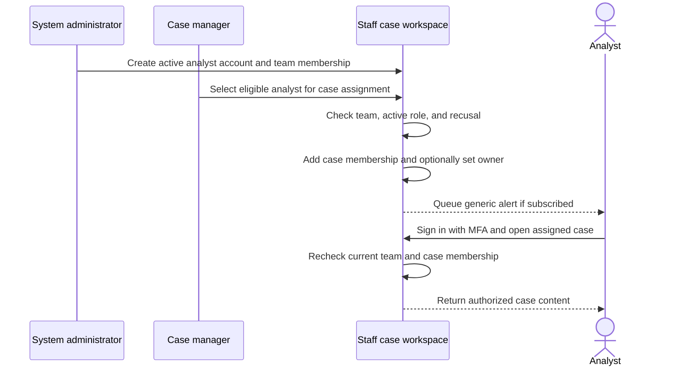
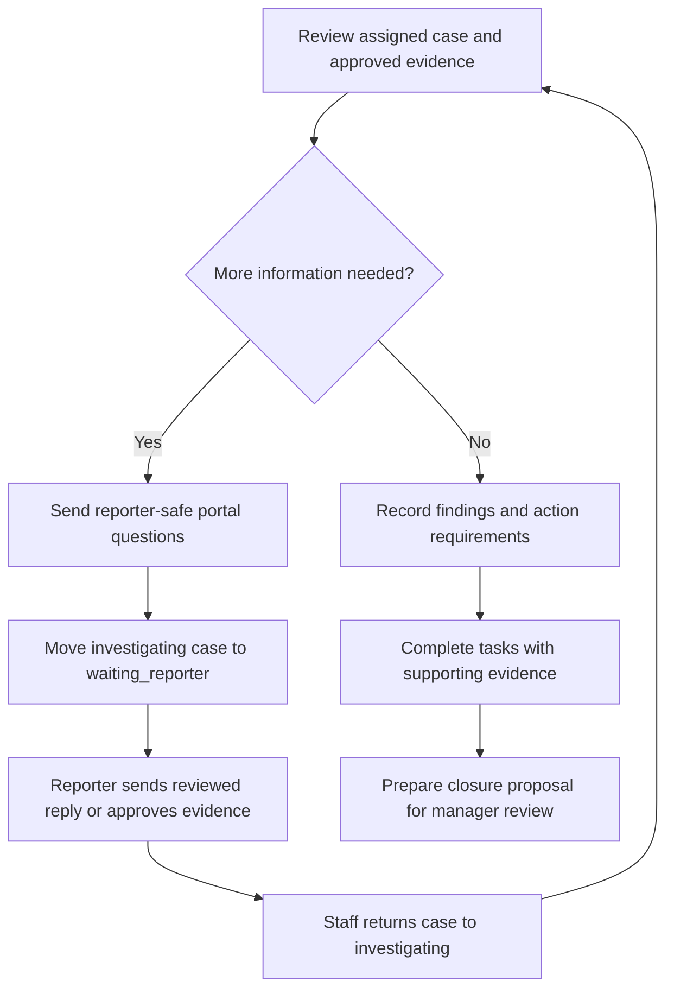
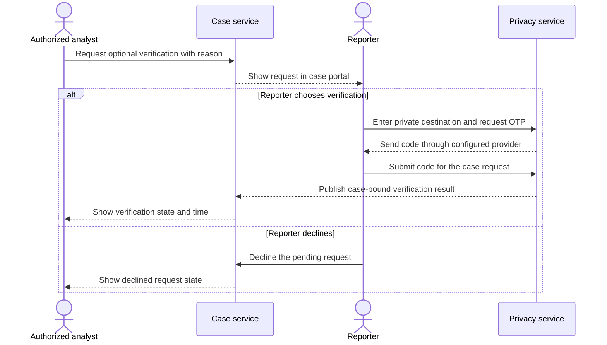

# Case analyst guide

This guide explains when an analyst becomes involved and how to investigate an assigned case. See the [reporting flow](reporting-flow.md), [manager guide](case-manager-guide.md), and [documentation index](README.md) for related context.

## 1. When the analyst becomes involved

An analyst joins after a manager assigns them to a case in their team. The application does not automatically assign analysts by category, business unit, workload, or seniority.

To access a case, an analyst must have:

1. An active analyst account and a staff session with MFA completed.
2. Current membership in the case's team.
3. An explicit, non-recused case membership created through manager assignment.

Team membership alone does not reveal the team's case queue to an analyst. Knowing a case identifier, owning a task, or receiving an email does not grant access. The same authorization applies to reading the case and downloading its approved evidence.

The manager may also make the analyst the case owner. Ownership expresses responsibility; it does not create a stronger investigation permission tier than ordinary case membership. Multiple analysts can be case members, but the case has one current owner.

The current case-overview form assigns the selected person as owner. The API can add members without changing the owner. Changing the owner does not automatically remove previously assigned investigators; managers should account for this during handoff.

Source: [assignment route](../apps/server/src/routes/cases.ts), [case authorization](../apps/server/src/service.ts), [staff authentication](../apps/server/src/auth.ts), [assignment UI](../apps/web/src/components/suite/investigation.tsx).

## 2. First actions on an assigned case

Open `/staff/cases` and select the case. Review its summary, submitted details, current state, classification, acknowledgment/follow-up dates, detriment alerts, existing evidence, messages, tasks, findings, and history.

Before investigating, assess whether you can act impartially. Use **Recuse** if you have a conflict. Recusal immediately removes your access, clears your case ownership if applicable, and alerts the remaining eligible staff. Coordinate the replacement with a manager through the team's agreed operating process; the application does not nominate one automatically.

Intended practice is for the manager to handle the initial acknowledgment and triage. The application also permits an authorized analyst to acknowledge, classify, and make ordinary state transitions. Agree who will do this so the team does not duplicate work.

Source: [case view](../apps/server/src/service.ts), [acknowledgment, recusal, and state actions](../apps/server/src/routes/cases.ts).

## 3. Investigation workspace

### Overview and assessment

Read the original report and its optional details. Reclassify category or severity when evidence warrants it. Record detriment risk and a protection plan; submitting `elevated` or `critical` risk requires a plan of at least ten characters. Reported retaliation should trigger protection review as well as fact gathering.

### Investigation notes and findings

Use notes for investigation activity, questions, and working observations. Use findings for supported conclusions and the basis for them. Both remain in the staff workspace and are not reporter mailbox messages.

Intended practice is to distinguish what was alleged, what was corroborated, what remains uncertain, and what further checks are needed. The application stores the entered text; it does not determine whether the evidence substantiates a finding.

### Evidence

Review and download the sanitized derivatives that the reporter has explicitly approved and published. Uploaded but unapproved material and sealed originals are unavailable through the staff evidence API. Ask for a clearer or additional reviewed document through the mailbox if needed. Do not treat sanitization as a guarantee that all identity clues have been removed.

### Actions and completion

Create a task for each investigation or corrective action that needs tracking. Select an eligible owner and a due date where appropriate. Complete it by supplying completion evidence of at least ten characters.

Task ownership does not grant case access. If the intended owner is another analyst who is not yet assigned, ask a manager to add them to the case. Authorized staff can complete a task even if they are not its named owner; team practice should ensure the completion evidence is credible and responsibilities are clear.

Root cause is recorded at closure in the current implementation. Actions are task records; they do not currently have separate structured root-cause or systemic-action fields.

Source: [investigation UI](../apps/web/src/components/suite/investigation.tsx), [records, task completion, classification, and evidence API](../apps/server/src/routes/cases.ts), [staff case view](../apps/server/src/service.ts).

## 4. Communicating with the reporter

Send questions and updates through the case **Messages** section. These messages are visible to the reporter, so use wording suitable for the reporter rather than internal analysis. Staff messages also record acknowledgment if missing and refresh the staff follow-up timestamp.

An analyst can ask the reporter to clarify dates, describe how they know, explain the impact, or provide additional reviewed evidence. Use the state `waiting_reporter` when an investigating case is waiting for that information. When information arrives, review it and explicitly return the case to `investigating`; a reporter reply does not change the state automatically.

Email and phone numbers are not part of the investigator view. If the reporter opts into verified notifications, the privacy service sends only a generic invitation to return to the portal. Delivery requires configured providers and can be delayed or fail; the mailbox is the substantive communication channel.

The private assistant is a reporter tool. Analysts cannot open its raw conversation or private drafts. A reporter-approved AI update arrives as a normal reporter mailbox message; evaluate its content as supplied information, alongside other evidence.

Source: [staff message and state routes](../apps/server/src/routes/cases.ts), [reporter messages](../apps/server/src/routes/reporter.ts), [case views](../apps/server/src/service.ts), [private notification jobs](../apps/privacy/src/jobs.ts), [assistant UI](../apps/web/src/components/suite/case-conversation.tsx).

## 5. Optional contact verification

If a contact-control check would help, submit a verification request with a reason of at least ten characters. The reporter sees the reason in `/case` and chooses whether to comply or decline.

Staff cannot select the reporter's destination, inspect the OTP, or retrieve the saved contact. Verification confirms destination control, not legal identity or employment, and is separate from allegation substantiation. A declined verification request does not remove case access or force closure. A new request supersedes earlier pending requests.

Source: [verification requests](../apps/server/src/routes/cases.ts), [reporter decline action](../apps/server/src/routes/reporter.ts), [private OTP checks](../apps/privacy/src/app.ts), [safe verification events](../apps/server/src/routes/internal.ts).

## 6. Preparing closure

When investigation is sufficient, prepare:

- An outcome: `substantiated`, `partially_substantiated`, `unsubstantiated`, `out_of_scope`, `duplicate`, or `withdrawn`.
- An internal rationale explaining the evidence and conclusion, at least twenty characters.
- A separate reporter-facing explanation, at least twenty characters, excluding confidential internal details.
- A root-cause category, or `not_applicable` where appropriate.
- A record of conflict checks, subject confidentiality, how the subject was heard, or why a response was deferred for legal or safety reasons.
- Completion evidence for every recorded task.

An authorized analyst can submit the closure proposal from `triage`, `investigating`, or `waiting_reporter`. Open tasks block the proposal. Successful submission moves the case to `closure_review` and alerts the team.

A manager who is not the proposer must approve or reject it. Analysts cannot approve closure, reopen a case, set legal holds, assign case members, or execute restricted escalation. If the proposal is rejected, the case returns to `investigating`; address the review reason and submit a revised proposal when ready.

The [manager guide](case-manager-guide.md#7-closure-proposal-and-independent-review) explains the exact review checks and their limits. In particular, the API accepts an omitted procedural-fairness object, and task completion is checked at proposal time rather than again at approval. Treat a complete investigation and fairness record as an operating responsibility.

Source: [closure proposal and review](../apps/server/src/routes/cases.ts), [closure form](../apps/web/src/components/suite/investigation.tsx), [closure enums](../packages/shared/src/suite.ts).

## 7. After closure and when access changes

Approved closure makes the public explanation available to the reporter. Ordinary messages, task/record changes, classification updates, new evidence uploads, and new AI work are blocked while the case is closed. Retained case information remains readable to authorized participants.

The reporter may request reopening or report detriment after closure. These actions alert staff without reopening automatically. Ask an authorized manager to reopen when further work is needed; normal investigation resumes in `investigating`.

Access can disappear if you recuse, leave the team, are deactivated, or the case is escalated to the independent restricted team. Restricted escalation clears existing case memberships and ownership; the new team's manager must assign eligible investigators again. Changing the owner alone does not revoke your earlier case membership.

Analysts can turn off alerts for an assigned case through its subscription setting. That affects notifications rather than access or responsibility; coordinate handoffs with the manager instead of relying on notification preferences.

Source: [case actions and restrictions](../apps/server/src/routes/cases.ts), [reporter post-closure actions](../apps/server/src/routes/reporter.ts), [staff/team administration](../apps/server/src/routes/admin.ts), [access rules](../apps/server/src/service.ts).
