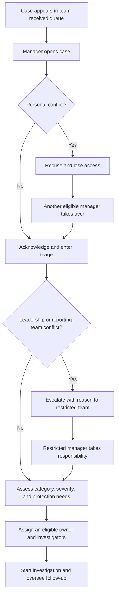
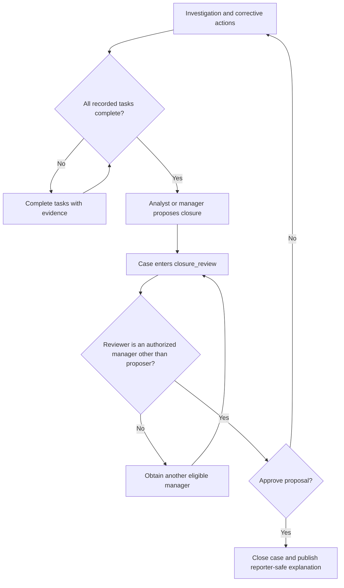

# Case manager guide

This guide explains how a manager receives a report, takes responsibility, brings analysts into the case, and oversees completion. See the [reporting flow](reporting-flow.md) for the reporter journey and [documentation index](README.md) for review scope.

## 1. How the case reaches a manager

Submission creates a case in `received` with a team but no automatically selected individual owner:

- Ordinary reports go to the configured default team.
- Reports marked sensitive go directly to the independent restricted team.

Every active, unrecused manager who belongs to that team can access the case. Managers do not need an individual case assignment to see their team's queue. Staff alerts are generic emails pointing to the staff portal; the system does not email the report narrative.

Sign in at `/staff/login` using the configured password or Google option and complete mandatory MFA. Open `/staff/cases`, filter by state or category as needed, and open a received case. Opening a case records a read and audit event; it does not automatically claim ownership or acknowledge receipt.

Source: [submission routing](../apps/server/src/routes/reporter.ts), [access rules](../apps/server/src/service.ts), [case list](../apps/server/src/routes/cases.ts), [staff alerts](../apps/server/src/jobs.ts).

## 2. Taking responsibility for a case

There is no separate “accept case” action or exclusive claim lock. The intended process is to nominate one accountable owner and record the initial assessment.

1. **Check for a conflict before working on the substance.** If you are implicated or cannot act impartially, use **Recuse**. This immediately removes your access and clears ownership if you were owner. Another eligible manager must handle the case.
2. **Acknowledge receipt.** Use the acknowledgment action, preferably with a brief portal message explaining that the case is being reviewed. The first state transition or staff message also records acknowledgment, but viewing and assignment alone do not.
3. **Move `received` to `triage`.** Review whether the concern is understandable, in scope, and routed safely.
4. **Record classification.** Set category and severity (`normal`, `high`, or `critical`). Assess detriment risk (`unassessed`, `low`, `elevated`, or `critical`). An elevated or critical risk requires a protection plan of at least ten characters when submitting that risk assessment.
5. **Decide who will investigate.** Assign yourself, another eligible manager, or an analyst as case owner. Use investigation notes to record the handoff and expectations.
6. **Move to `investigating`** when investigation starts. If further facts are needed, staff can use `waiting_reporter` after investigation has started.

Owner selection identifies responsibility; it does not give the owner exclusive access. Other eligible team managers and assigned analysts can continue to work on the case.

Source: [case acknowledgment, classification, assignment, recusal, and states](../apps/server/src/routes/cases.ts), [staff case workspace](../apps/web/src/components/suite/investigation.tsx).

## 3. Bringing an analyst into the case

An analyst's active account and team membership alone do not grant access. The analyst needs an explicit case membership as well. Only a manager with access to the case can use the case assignment action.

The selected person must be active, belong to the case's current team, have an analyst or manager role, and not be recused from this case. An administrator account cannot be assigned as an investigator.

In the case overview, the assignment selector and owner action add the selected person as a case member and make them the current owner. The API also supports adding a member without changing ownership through `POST /api/cases/:id/assign` with `owner: false`. The current overview form always sends `owner: true`; it does not provide a separate member-only control.

**Important handoff details:**

- Assigning a new owner does not remove the previous owner's case membership. Reassignment can therefore leave multiple investigators with access.
- Assigning a task to an analyst does not create case membership. Arrange case assignment first, then assign tasks.
- Analyst subscriptions control alerts, not access. Assigned analysts can turn their alerts off; team managers continue to receive team alerts.
- Removing team membership revokes eligibility. Recusal also blocks further assignment to that case through the ordinary assignment route.

Intended practice is to brief the analyst through internal notes and clear task ownership: what needs checking, which evidence supports the concern, what remains unknown, deadlines, and any protection precautions. The [analyst guide](case-analyst-guide.md) describes their work after assignment.

Source: [assignment API](../apps/server/src/routes/cases.ts), [access predicate](../apps/server/src/service.ts), [overview assignment form](../apps/web/src/components/suite/investigation.tsx), [team membership updates](../apps/server/src/routes/admin.ts).

## 4. Triage and protection decisions

During triage, consider the alleged conduct, urgency, available evidence, potential harm, retaliation concerns, and conflicts. Ask for clarification through the portal when needed. Treat contact verification as proof of contact control only; it is not a condition for taking a report seriously.

Reporters can submit dedicated detriment reports, including after closure. These create a case record, set a visible detriment flag, and alert the team. Review the concern and document protection measures. Submitting an assessed risk other than `unassessed` clears the active flag; the underlying detriment report remains recorded. A closed case must be reopened before its classification or protection plan can be updated.

**Implementation boundary:** an unassessed risk or active detriment flag is not itself a closure blocker. Managers should make protection review an explicit operating check. The current implementation has no separate detriment-resolution endpoint.

Source: [classification and protection validation](../apps/server/src/routes/cases.ts), [reporter detriment submission](../apps/server/src/routes/reporter.ts), [case view visibility](../apps/server/src/service.ts).

## 5. Independent escalation and recusal

If a normal case concerns leadership or the reporting team, use the restricted escalation action with a reason of at least ten characters. The application:

1. Marks the case sensitive and changes its team to the configured restricted team.
2. Clears the current owner and deletes existing case memberships.
3. Records the escalation reason and audit event.
4. Queues an alert for the new team.

Normal-team investigators lose access because their team membership no longer matches. Restricted-team managers can see the case and must arrange its owner and analyst assignments. A sensitive report already follows that route from submission. The current workflow provides escalation to restricted handling, not a general team-transfer or de-escalation action.

Recusal is individual: it removes the recusing person's access. It does not itself route the case to another team or nominate a replacement owner.

Source: [escalation and recusal routes](../apps/server/src/routes/cases.ts), [team separation rules](../apps/server/src/routes/admin.ts).

## 6. Oversight during investigation

Use the case workspace sections for overview and assessment, investigation notes/findings, messages and verification requests, evidence, actions, closure/legal hold, and history.

Managers can perform ordinary investigation actions themselves. Analysts have the same ordinary case work capabilities once authorized; assignment, escalation, closure approval, reopening, and legal holds remain manager-only actions.

Oversee these practices:

- Keep questions and substantive answers in the portal mailbox. Contact destinations and raw private AI conversations are unavailable to staff.
- Review approved sanitized evidence; staff cannot retrieve sealed originals through the case API.
- Record findings separately from assumptions and list any unresolved questions.
- Give actions a clear owner, due date where appropriate, and completion evidence.
- Review acknowledgment and follow-up deadlines and overdue tasks. Default intervals are seven and thirty days, but the administrator's current settings govern the deployment.

Acknowledgment is due from creation. Follow-up is due from the last staff response, or creation if there has been no staff response. A staff message or explicit acknowledgment refreshes that response timestamp; assigning or reading a case and receiving a reporter reply do not. Overdue jobs queue staff reminders, deduplicated per case and UTC date, when company setup and retention configuration are complete. They do not automatically assign, resolve, or close a case.

Source: [staff workspace sections](../apps/web/src/components/suite/staff-navigation.ts), [case actions](../apps/server/src/routes/cases.ts), [deadline calculation](../apps/server/src/service.ts), [overdue jobs](../apps/server/src/jobs.ts).

## 7. Closure proposal and independent review

An authorized analyst or manager can propose closure from `triage`, `investigating`, or `waiting_reporter`. The proposer supplies an outcome, internal rationale, reporter-facing explanation, and root-cause category. All recorded tasks must be completed before the proposal can enter `closure_review`.

The available outcomes are `substantiated`, `partially_substantiated`, `unsubstantiated`, `out_of_scope`, `duplicate`, and `withdrawn`. Root-cause categories are `control_gap`, `policy_gap`, `training_gap`, `culture_leadership`, `individual_misconduct`, `third_party`, and `not_applicable`.

The closure form also supports conflict and confidentiality attestations, the subject's response status (`heard`, `deferred_legal_or_safety`, or `not_applicable`), and a rationale. Intended practice is to record how procedural fairness was handled before submitting the proposal.

A manager who can access the case and **is not the proposer** reviews it. The reviewer records a reason of at least ten characters:

- **Approve:** moves the case to `closed`, records the reviewer and closure date, and makes the public explanation available to the reporter.
- **Reject:** returns the case to `investigating`, preserving the proposal/review information until a later proposal replaces it.

### Implementation boundaries for the reviewer

- Independence is checked against the proposer, not against everyone who participated in the investigation. The application does not require a reviewer from another team.
- The procedural-fairness object is optional in the API. If supplied for a substantiated or partially substantiated outcome, a response status other than `not_applicable` and a rationale of at least ten characters are required. Omitting the object bypasses that particular check; staff practice must cover the attestation consistently.
- Open tasks are checked when closure is proposed. The approval route does not repeat that check, and authorized staff can still add tasks during `closure_review`. Review the current action list before approval.
- Notes, findings, risk assessment, a nominated owner, and contact verification are not mandatory server-side closure prerequisites. Judge the case record, rather than treating an available approval button as proof of completeness.

Source: [closure and review API](../apps/server/src/routes/cases.ts), [closure UI](../apps/web/src/components/suite/investigation.tsx), [closure values](../packages/shared/src/suite.ts).

## 8. Reopening, legal holds, and accountability

A reporter's reopening request records a reason and alerts staff; it does not change the state. An authorized manager can reopen a closed case with a reason. The case returns to `investigating`, its previous closure is retained in an internal note, and fresh investigation and closure review can follow.

An authorized manager can enable or remove a legal hold with a reason. Holds suspend the applicable retention deletion processes; the system may refuse a new hold while a conflicting privacy-retention operation is in progress. Review retention and holds before old case material is deleted.

Case history records views and workflow actions such as assignment, acknowledgment, classification, messages, recusal, escalation, closure decisions, reopening, and holds. Team managers remain accountable for responding to alerts, handling conflicts, and ensuring an unconflicted reviewer remains available.

Source: [reopening and hold actions](../apps/server/src/routes/cases.ts), [reporter reopening requests](../apps/server/src/routes/reporter.ts), [retention jobs](../apps/server/src/jobs.ts).
