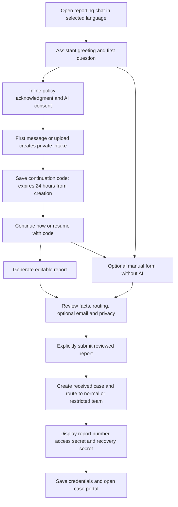
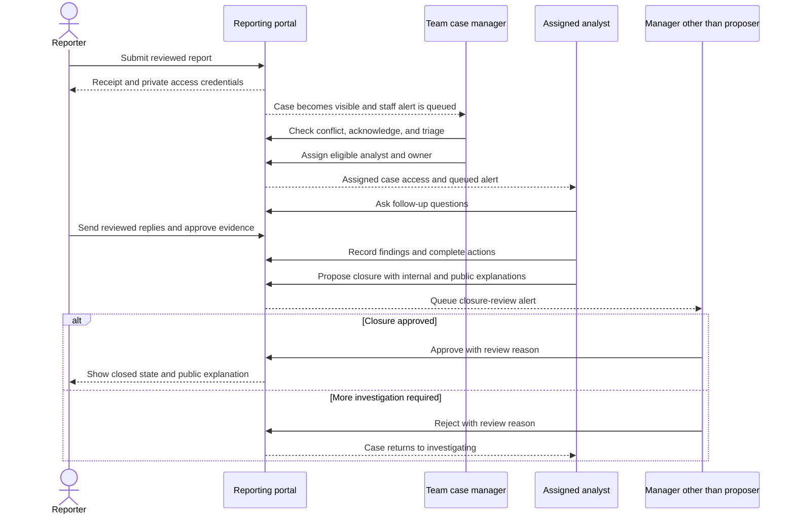
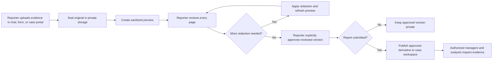
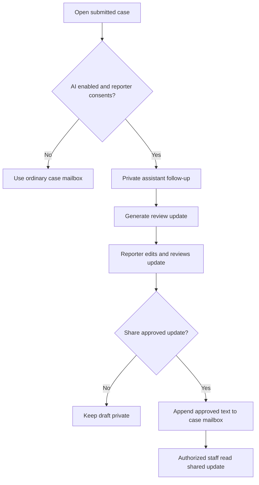
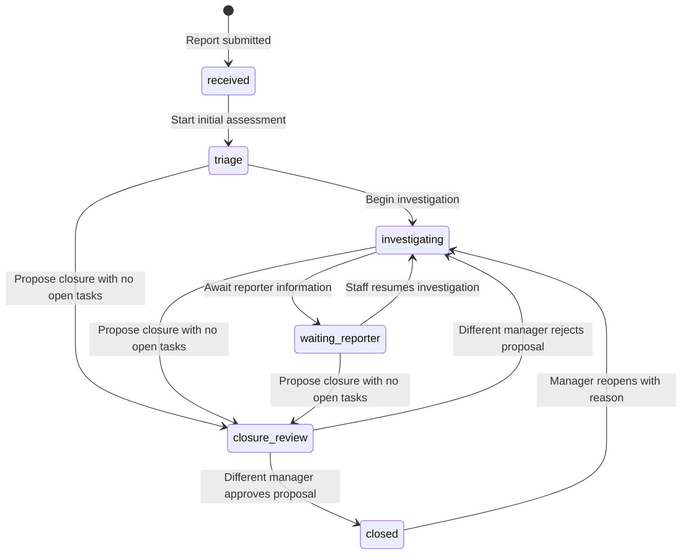

# Intended reporting flow

This guide follows a concern from the reporter's first visit through investigation, closure, and possible reopening. For review date, source revision, and historical-document differences, see the [documentation index](README.md).

## 1. Participants and responsibilities

- **Reporter:** submits a concern, saves private access credentials, reviews anything shared with staff, and returns to the case portal for follow-up. No staff account is required.
- **Case manager (`manager`):** receives cases routed to their team, handles initial review and conflicts, assigns investigators, oversees protection and deadlines, and reviews closure proposals made by another person.
- **Case analyst (`analyst`):** investigates cases explicitly assigned to them within their current team. Analysts can communicate with reporters, review approved evidence, record findings and actions, and propose closure.
- **System administrator (`admin`):** configures staff, teams, company policy, categories, deadlines, and retention. This role has no case-content access through the staff case API.
- **Privacy service:** holds optional contact destinations, private assistant conversations, and sealed evidence originals separately from the case workspace. Application staff have no contact-reveal endpoint.

The manager role and case ownership are separate concepts: an analyst can be the case owner, while managers retain oversight of cases in their team. See the [manager guide](case-manager-guide.md) and [analyst guide](case-analyst-guide.md).

## 2. Before opening the reporting channel

An administrator configures the company policy and privacy notice in English and Indonesian, categories, any business units, acknowledgment and follow-up intervals, and retention periods for cases, contacts, evidence, transcripts, audit, and backups.

The deployment needs a normal reporting team and an independent restricted team. Saving complete settings requires at least two active managers in each team and no overlapping membership between the configured teams. Production submission is blocked until company setup is complete. Staff authenticate with mandatory MFA; Google sign-in, when configured, still requires local MFA.

These are setup checks, not a guarantee that later staff changes preserve reviewer availability. The administrator and managers should keep enough unconflicted reviewers available.

Source: [company configuration and teams](../apps/server/src/routes/admin.ts), [staff authentication](../apps/server/src/auth.ts), [Google login](../apps/server/src/routes/google.ts).

## 3. Reporter entry and submission

1. Open `/report`. The private assistant immediately greets the reporter and asks what happened in the selected language (English or Indonesian).
2. Read the policy and privacy notice inline and acknowledge them. Consent is required before sending any content to MiniMax. No report form or email-verification gate precedes the conversation.
3. Send the first message or attach evidence. Uploading needs policy acknowledgment, but does not need AI consent. The privacy service creates an encrypted private intake and displays one secret **continuation code**. Save it: anyone holding it can access the unfinished conversation. It is not a report number.
4. Continue answering focused questions. Changing the language selector changes subsequent replies and generated drafts; earlier messages stay in their original language. Unknown facts can remain unknown.
5. Return using **Continue a conversation** on the home or report page and enter the code. Messages and saved review edits are restored across devices. The code expires exactly **24 hours after creation**, without extension, and expired unsubmitted conversations are deleted by cleanup.
6. Choose **Review report** to generate an editable report. Review the title, summary, optional details, category, relationship, business unit, and independent sensitive-routing choice. Review edits are saved privately; a Save draft action is also available. Optional notification email is never sent to AI.
7. Confirm the current policy and review the report for identifying information, then explicitly **Submit report**. Only this approved report enters the staff workspace. Conversation messages alone never create a case or alert staff.

**Use a form instead** remains available when consent is declined, AI is disabled, the provider fails, or AI allowance runs out. Existing review edits or the latest generated draft are preserved; the reporter can complete the form without another AI request. The same evidence controls remain available beside the manual form. Processing and unapproved evidence never block report submission.

Continuation codes are held only in browser memory and stored as hashes in the privacy database. They do not appear in URLs, logs, or browser storage. Save or download the code before leaving the page. Optional contact verification is offered only after submission for notifications, never admission or email recovery.

The server checks current company policy, categories, and business units. A policy change requires fresh acknowledgment. Submission retries reuse the browser's submission identifier and case secrets. Intake reservation prevents concurrent browsers from creating separate cases from the same conversation and permits retry after a rolled-back case transaction. Successful submission retires continuation-code access; use the final case credentials thereafter. As with the existing receipt, final secrets cannot be retrieved after reloading an unsaved receipt.

Source: [reporting page](../apps/web/src/app/report/page.tsx), [private intake API](../apps/privacy/src/intake.ts), [submission API](../apps/server/src/routes/reporter.ts), and [private reservation](../apps/privacy/src/admission.ts).

## 4. Receipt, notifications, and returning to a case

The receipt displays three values:

- **Case code:** identifies the case.
- **Access secret:** called `pin` in the API; used with the case code to sign in again.
- **Recovery secret:** called `recoveryCode` in the API; used with the case code to recover access if the access secret is lost.

The reporter can copy or download these credentials and must confirm saving them before proceeding. Submission also starts a reporter session. Receipt secrets are not kept as retrievable plaintext by the server; reloading an unsaved receipt can lose them.

If an email was supplied and email delivery is configured, the receipt offers a six-digit OTP to activate notifications. The challenge lasts five minutes. Verification can be deferred, and contacts can be added or managed later in `/case`. Email and phone contacts depend on the corresponding delivery provider being configured. Only verified contacts with notifications enabled receive generic alerts to return to the portal.

Verification proves control of a destination. It does not establish legal identity, employment, or whether an allegation is true. Optional notification contacts do not enable email-based case recovery.

On a later visit, the reporter opens `/case` and signs in with their case code and access secret. Recovery replaces both secrets and invalidates earlier access sessions/capabilities. The reporter must save the replacements. There is no email lookup or staff recovery override; losing access to both secrets leaves no supported recovery path.

Source: [receipt component](../apps/web/src/components/suite/common.tsx), [case portal](../apps/web/src/app/case/page.tsx), [reporter sessions and recovery](../apps/server/src/routes/reporter.ts), [private contacts](../apps/privacy/src/app.ts), [notification delivery](../apps/privacy/src/jobs.ts).

## 5. What happens after submission

The case starts as `received`, routed to the configured normal or restricted team. No individual owner is automatically selected. Team managers can see it without individual assignment, and a generic staff alert is queued.

The intended handoff is:

1. A manager opens the case, checks conflicts, acknowledges receipt, and moves it into triage.
2. The manager assesses category, severity, protection needs, and whether restricted handling is necessary.
3. The manager assigns an eligible analyst or manager as owner and coordinates investigation.
4. Assigned analysts gather facts through the portal, record findings, and track actions.
5. An authorized investigator proposes closure after completing recorded actions.
6. A manager other than the proposer approves closure or returns the case to investigation.

An arrow for a queued alert does not mean delivery is immediate or guaranteed. Staff alerts contain a sign-in link, not case content. The portal is the working record.

Source: [case workflow](../apps/server/src/routes/cases.ts), [staff access and case views](../apps/server/src/service.ts), [staff notification jobs](../apps/server/src/jobs.ts).

## 6. Reporter mailbox, evidence, and optional AI

### Portal messages

The reporter and authorized staff exchange messages inside the case portal. Reporters confirm reviewing outgoing content. Staff messages are visible to the reporter, while investigation notes, findings, task details, protection plans, and internal closure rationale remain in the staff workspace. Staff messages appear as staff messages rather than disclosing the sender's staff identity in the reporter case view.

### Evidence

Before the first message, beside the chat or manual form, and later in `/case`, the reporter can upload PNG/JPEG/WebP images, PDFs, DOCX, XLSX, or PPTX files. Limits are 20 MB per file, 20 files, and 200 MB per draft/case. Uploads do not require AI consent, and neither files, filenames, nor extracted content are sent to AI. The privacy service seals the original, creates a sanitized preview, and lets the reporter review every page and apply permanent redactions. Before submission, even approved evidence stays private. Once the case is committed, files move to case ownership and only explicitly approved sanitized versions are published to the staff evidence workspace. Unapproved or processing files remain private and can be reviewed later in the case portal. Discarded or expired unsubmitted drafts queue deletion of both original and derivative files; storage failures are retried. Processing can fail; an uploaded file is not automatically shared evidence.

### Optional private assistant

With company enablement, provider configuration, and reporter consent, the assistant continues privately after submission through the case portal. The pre-submission transcript remains private and is accessible through case credentials. It uses the submitted information to clarify missing facts; it does not take the manager's or analyst's role.

The raw conversation and generated review drafts stay in the privacy service. **Review update** produces an editable structured follow-up. Only an update explicitly reviewed and shared by the reporter becomes a case mailbox message. The original report remains unchanged.

AI allows 30 message attempts and three draft-generation attempts per intake per UTC day. The localized static intake greeting does not consume an attempt. Submission carries intake usage into the case allowance; case assistant initialization consumes a message attempt when needed. Provider failures consume an attempt; replaying an existing request does not. Declining AI, provider failure, or exhausted AI allowance does not prevent ordinary reporting or case access. Retention and legal holds apply to private history; it is not promised indefinitely.

Source: [case portal](../apps/web/src/app/case/page.tsx), [evidence UI](../apps/web/src/components/suite/evidence.tsx), [private evidence and contact API](../apps/privacy/src/app.ts), [assistant UI](../apps/web/src/components/suite/case-conversation.tsx), [private conversation processing](../apps/privacy/src/conversation.ts).

## 7. Case states and transitions

These are the current suite states. Older `new`, `under_review`, and `closed_resolved` definitions in [status.ts](../packages/shared/src/status.ts) do not describe this workflow.

Acknowledgment is a separate timestamp, not a state. Explicit acknowledgment, the first ordinary state transition, or a staff message can set it. Merely opening, assigning, or classifying a case does not acknowledge it. A reporter reply does not automatically move `waiting_reporter` back to `investigating`; staff make that transition.

Restricted escalation changes the team and access rather than creating a separate lifecycle state. Closure must use the proposal and review actions; a direct state change to `closed` is rejected.

Source: [current state definitions](../packages/shared/src/suite.ts), [transition and closure routes](../apps/server/src/routes/cases.ts).

## 8. Closure, feedback, retaliation, and reopening

Approved closure shows the reporter the public explanation. Ordinary messages, new evidence uploads, and new assistant work are unavailable while closed. Existing retained case information remains accessible with case credentials.

The reporter can:

- Submit one feedback response with 1–5 ratings for trust, communication, and protection.
- Report retaliation or detriment, including after closure. This records the concern, flags the case, and queues staff attention; it does not reopen the case automatically.
- Request reopening with a reason. This records a request for staff; a manager must separately reopen the case.

Managers should reopen a closed case when new information or protection concerns require further investigation. Reopening returns it to `investigating`, preserves the previous closure in an internal record, and allows normal work again.

Configured retention can eventually delete closed case data unless a legal hold applies. Optional contacts, transcripts, and evidence have their own retention treatment. Contact isolation does not prevent a narrative, distinctive circumstance, or document from identifying someone; reporter review remains necessary.

Source: [reporter follow-up, feedback, detriment, and reopen requests](../apps/server/src/routes/reporter.ts), [manager reopening and holds](../apps/server/src/routes/cases.ts), [case retention jobs](../apps/server/src/jobs.ts), [private retention jobs](../apps/privacy/src/jobs.ts).
